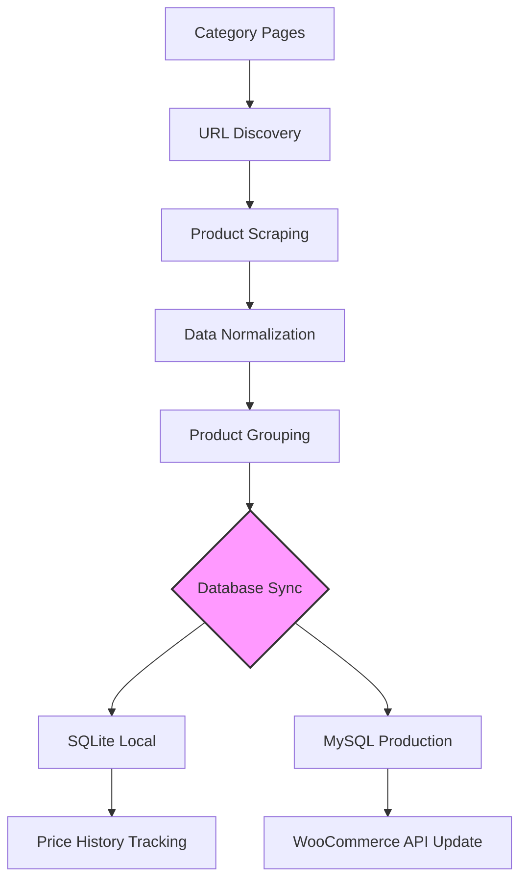

## E-commerce Product Synchronization Pipeline

An automated system designed for the collection, normalization, and synchronization of e-commerce product data to WooCommerce.
Key Features

    Discovery & Scraping: Automated URL discovery and data extraction from category pages.

    Data Normalization: Cleaning, deduplication, and standardization of product titles, descriptions, and specifications.

    Dual Database Sync: Concurrent synchronization with SQLite (local cache) and MySQL (production).

    Price Tracking: Historical price logging and trend analysis.

    WooCommerce Integration: Automated product creation and inventory updates via REST API (utilizing delta updates).

Architecture

Discovery → Scraping → Normalization → Database Storage → WooCommerce Sync.
Implementation Status

    Production-ready: Includes robust error handling, retry mechanisms, and a 7-day rotation logging system.

    Performance: Optimized API usage through delta updates, reducing unnecessary data overhead.

## Features

- Product discovery from category pages

- Product data extraction and normalization

- SQLite storage

- MySQL synchronization

- Historical price tracking

- WooCommerce product creation

- WooCommerce inventory updates

- Duplicate detection

- Change detection

  
- ## Workflow

1. Discover product URLs

2. Extract product information

3. Normalize technical specifications

4. Synchronize SQLite database

5. Synchronize MySQL database

6. Track price changes

7. Update WooCommerce catalog

## Tech Stack


- Python

- SQLite

- MySQL

- BeautifulSoup

- Requests



### REPORT

```text
========================================
 JOB REPORT
========================================
Categories Scanned : 3
Total URLs Found: 78
Products Approved : 35
Database Updated : OK
WooCommerce Updated : OK
Status : Success
Duration of job  : 14.93 mins
========================================
```


Built with Python and enhanced through AI-assisted development.

