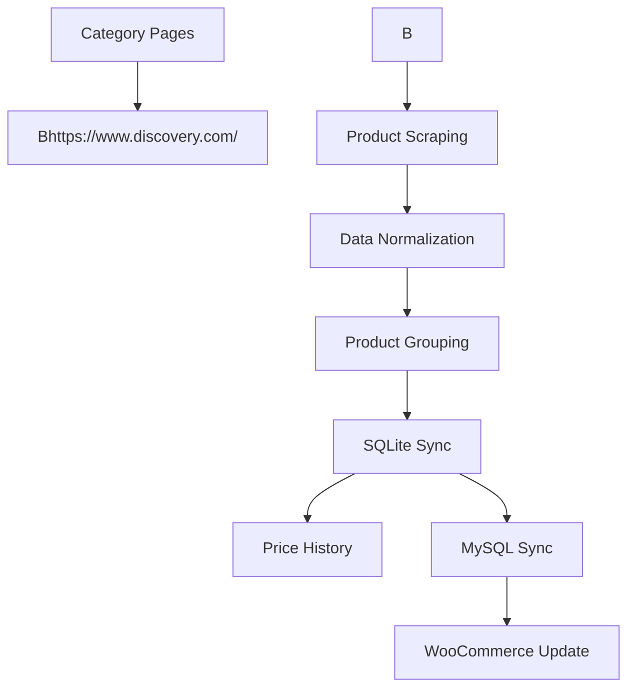

# E-commerce Product Synchronization Pipeline

Automated product discovery, normalization,

database synchronization and WooCommerce integration., ## Features

- Product discovery from category pages

- Product data extraction and normalization

- SQLite storage

- MySQL synchronization

- Historical price tracking

- WooCommerce product creation

- WooCommerce inventory updates

- Duplicate detection

- Change detection, ## Workflow

1. Discover product URLs

2. Extract product information

3. Normalize technical specifications

4. Synchronize SQLite database

5. Synchronize MySQL database

6. Track price changes

7. Update WooCommerce catalog, ## Tech Stack

- Python

- SQLite

- MySQL

- BeautifulSoup

- Requests

Built with ❤️ using Python & AI-Assisted Development

* **Καθαρότητα**: Δεν χρειάζεται να βάζεις URLs ή περίεργα σύμβολα μέσα στο διάγραμμα. Το Mermaid σχεδιάζει τις γραμμές αυτόματα.

**Δοκίμασέ το και θα δεις τη διαφορά αμέσως.** Αν και πάλι δεν εμφανιστεί διάγραμμα, τότε το GitHub μπορεί να μην έχει ενεργοποιήσει το Mermaid στο συγκεκριμένο repo (αν και πλέον είναι στάνταρ σε όλα). Αν δεν παίξει ούτε έτσι, τότε η μόνη ρεαλιστική λύση για να φαίνεται όμορφο είναι να το ανεβάσεις ως μια **εικόνα (PNG/JPG)** μέσα στον φάκελο `docs/` και να βάλεις ένα link στο README: ``.

Θέλεις να το δοκιμάσεις έτσι και να μου πεις αν έπαιξε;

